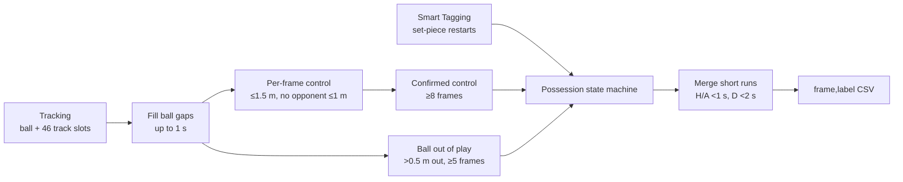

# DX Lab Team 3 — More Than a Hack 2027, Phase 1: ball possession

A rule-based system that labels every frame of FC Barcelona vs Athletic Club
(LaLiga 2024-25, MD2) as **H** (Barça in possession), **A** (Athletic in possession),
**D** (dead ball) or **X** (not graded), from automatic tracking data and Smart Tagging.

No training and no tuning. Every parameter comes from the published literature, the Laws of
the Game, or a football-logic design choice fixed before any scoring. Each one is cited in
[`src/possession/config.py`](src/possession/config.py).

**Technical document:** [`docs/TECHNICAL.md`](docs/TECHNICAL.md)

## Result on the public 5-minute window

| | spellF1 | macroF1 | possessions | fragmentation |
|---|---|---|---|---|
| **This submission (v1)** | **0.388** | 0.601 | 16 | 0.81 |
| Organisers' `baseline_smooth50` (published floor) | 0.326 | 0.621 | 26 | 1.43 |
| Ground truth | — | — | 17 | — |

The public window holds only 17 possessions. It was used to check that the pipeline is correct,
never to choose parameters (see the organisers' Nov 3 rule clarification).

## How it works



Possession only changes hands when the **other** team gets confirmed control. While the ball is
missing, contested or in the air, the last state holds. Full rules: [technical document](docs/TECHNICAL.md).

## Reproduce

Requires [uv](https://docs.astral.sh/uv/) and the match data bundle (not included; the data is
not redistributable).

```bash
uv sync --frozen                    # Python 3.11, exact pins from uv.lock
# unpack the bundle into ./data (layout in data/README.md), or set MTAH_DATA_DIR
make submission TEAM=DX_Lab_Team_3  # build -> validate -> score on the public window
make reproduce  TEAM=DX_Lab_Team_3  # rebuild twice, check the file is byte-identical
make test                           # 75 unit tests on synthetic data, no match data needed
```

Output: `submissions/DX_Lab_Team_3.csv`. The pipeline is deterministic (no randomness).

## Layout

| Path | What |
|---|---|
| `src/possession/config.py` | every parameter, with its source |
| `src/possession/core.py` | the rules, as pure numpy functions |
| `src/possession/loaders.py` | the only module that reads match data |
| `src/possession/pipeline.py` | entry point: data in, CSV out |
| `src/possession/diagnostics.py` | counts-only run summary |
| `tests/` | unit tests on synthetic matches |
| `evaluation/`, `starter/`, `games.py` | organisers' code, unmodified (checked by `evaluation.sha256`) |

The organisers' original README is kept as [`ORGANISERS_README.md`](ORGANISERS_README.md).
