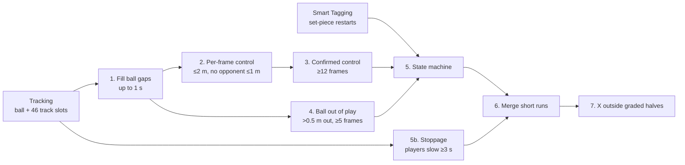
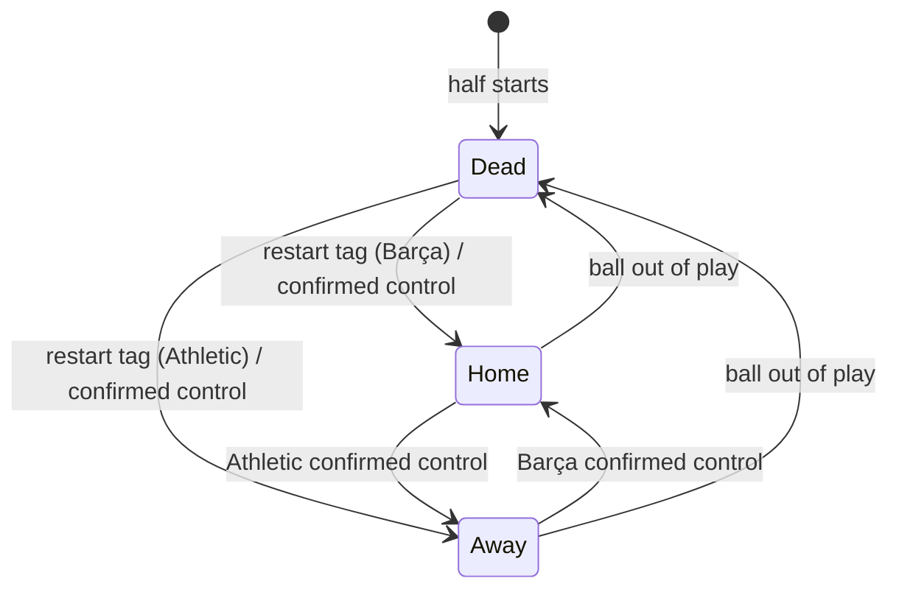

# DX Lab Team 3 — Technical document

More Than a Hack 2027, Initial Challenge: frame-by-frame team possession for FC Barcelona vs
Athletic Club (LaLiga 2024-25, MD2). Submission: `DX_Lab_Team_3.csv`, 199,319 rows.

## 1. Approach

The ranking metric, spellF1, scores **possessions**, not frames. A possession is a maximal run of
`H` or `A`, matched to the truth by temporal IoU. The organisers' baselines make the point: the
nearest-player rule is right on most frames, but it flips team on every pass and loose ball, so
it predicts 131 possessions where the public window has 17 and scores spellF1 0.04.

So the main design question is not "who is closest to the ball on this frame?" but **"when does
possession actually change hands?"** We answer it with a small set of football rules and a state
machine, instead of smoothing a per-frame guess:

- a team gains possession only when it shows **confirmed control** of the ball;
- anything short of that (a deflection, a contested ball, a pass in flight, a frame where the
  tracking lost the ball) **keeps the previous state**;
- the ball is **dead** when it is clearly out of the pitch, and stays dead until a **restart**,
  taken from Smart Tagging, or until play has visibly resumed;
- the ball is also **dead while play is stopped**: when the players are collectively slow for
  several seconds, with no ball seen moving among them. This catches fouls, injuries and the wait
  before a restart, and it needs neither the ball nor player identities.

We chose a rule-based system over a learned model on purpose:

1. **The rules forbid fitting to this match.** Training, fitting or calibrating on the ground
   truth or the video is not allowed (rule clarification, Nov 3), and the public ground truth is
   only 5 minutes long anyway.
2. **The ground truth is mechanical.** It is derived from corrected tracking ("owning team" and
   "ball dead"), so explicit geometric rules aim at the same definition.
3. **It is inspectable.** Every decision in the output traces back to one rule and one parameter.

## 2. Assets used, and dropped

| Asset | Used? | How / why not |
|---|---|---|
| Tactical ATD (tracking) | **Yes** | Ball and player positions per frame, team membership per track slot. Read with kloppy's EPTS metadata parser and streaming reader, scaled to metres with the `games.py` pitch (105.3 × 68.0 m). |
| Smart Tagging | **Yes, set pieces only** | The `SET PIECES` code gives restarts (kickoffs, throw-ins, corners, goal kicks, free kicks) and, for most types, the team taking them. They end dead-ball periods. |
| `games.py` | Yes | Pitch size, frame counts and the graded half boundaries. |
| Homography | No | The ATD already gives pitch coordinates, so the camera model adds nothing for a position-based method. |
| Tactical video | No | Not needed for a position-based method. The rules also forbid checking output against it. |
| Broadcast recording | No | Not synchronised to the tactical timeline, and its homography covers only 65.8% of frames. |
| ATD `ball_state` / `ball_owning_team_id` | Checked, dropped | Empty on every frame of this file. |
| SkillCorner open data (other games) | **Yes, tuning and validation** | 20 A-League 2024/25 matches (MIT licence) with provider possession labels. Used to choose parameter values and to measure the method on matches it was not built on (section 5). Never mixed into the competition run. |
| Metrica public sample games 1 and 2 (other games) | **Yes, tuning and validation** | Same provider and frame rate as the competition tracking. Used to set and test the stoppage detector (section 5). |

No pre-trained models. No hand labels and no human-produced data about the provided game.

### Labelled data used (all from other games)

| Dataset | Source | Who labelled it | How much | Used for |
|---|---|---|---|---|
| SkillCorner open data, A-League 2024/25 | https://github.com/SkillCorner/opendata, revision `4340d27`, MIT licence | SkillCorner (the provider's own "phases of play" and dynamic events, shipped with the dataset). We added no labels. | 20 matches: 10 development, 10 held-out | Choosing parameter values (development) and measuring the method (held-out). See section 5. |
| Metrica Sports sample data, games 1 and 2 (anonymised) | https://github.com/metrica-sports/sample-data, revision `e706dd5` (public; the repository asks for acknowledgement) | Metrica Sports: dead ball is where their tracking gives the ball no position; possession is the team of their latest on-ball event. We added no labels. | 2 matches: game 1 development, game 2 held-out | Setting and testing the stoppage detector. See section 5. |

No model was trained. Nothing labelled comes from the provided game.

## 3. Pipeline and possession rules



### 3.1 Ball gaps
The ball is missing on about 41% of graded frames. Gaps of **up to 25 frames (1 s)** are filled
by linear interpolation between the observed frames on each side. Longer gaps stay empty, and the
state machine holds its state through them rather than guessing.

### 3.2 Control on one frame
A team **controls** the ball on a frame when its nearest player is within **2.0 m** of the ball
and **no opponent is within 1.0 m**. Two opponents close to the ball make it a duel, and a duel
means nobody controls it.

### 3.3 Confirmed control
Control by the same team for **at least 12 consecutive frames (0.48 s)** counts as confirmed. The
gain is dated to the **first** frame of that run, so a possession starts where control began,
not where it was confirmed.

This is our line between "touched" and "controlled". A deflection, a block or a pass flying past
a defender gives a few frames of proximity at most, not half a second of uncontested control.

### 3.4 Dead ball
- **Out of play:** the ball is more than **0.5 m** outside a touchline or goal line for at least
  **5 consecutive frames (0.2 s)**. The margin and the run length keep tracking noise near the
  lines from creating false stoppages. A frame with no ball position breaks the run.
- **Restart:** the dead ball ends at whichever comes first:
  - the **next set-piece tag**. Possession goes to the tagged team; when the tag has no team (all
    throw-ins are tagged `N/A`), it goes to the first team to get confirmed control afterwards;
  - the ball **seen back inside the lines, followed by a confirmed control**. This covers restarts
    that Smart Tagging missed.
- **Possible goal:** an exit over a goal line **between the posts** (half-width 3.66 m, Law 1,
  plus 0.5 m) ends only at the next **kickoff, goal kick or corner** tag. Without this, players
  carrying the ball back to the centre spot after a goal would look like play resuming. The
  tracking has no ball height, so a shot over the bar looks like a goal; it is followed by a goal
  kick or a corner, which ends it correctly.
- **Start of each half:** the half starts dead and goes live at its kickoff tag. A tag whose
  window covers the first graded frame fires on that frame.

### 3.5 Stoppages (dead ball without the ball leaving the pitch)
Most dead-ball time is not the ball crossing a line: it is fouls, injuries, substitutions and the
wait before a restart. On external data, the ball-out rule alone called 15–22% of frames dead
where the providers' labels have 39–46%.

So a frame is also `D` while **play is stopped**:
- each track slot's speed is its displacement over 1 s (this averages out tracking jitter; a slot
  implying more than 12 m/s is a track swap and is ignored);
- the **mean player speed**, averaged over a 3 s window, is below **1.35 m/s**, for **at least
  3 s**. On both external providers the mean speed is around 1.0 m/s when the ball is dead and
  2.0 m/s when it is live;
- **veto:** where the ball is seen travelling at 3 m/s or more, slow players mean slow build-up,
  not a stoppage. A missing ball vetoes nothing, so the rule works through ball gaps.

The state machine keeps running underneath. When play resumes, possession is whatever it holds:
the previous team, unless the other team took confirmed control during the stoppage (for example
picking the ball up for a free kick).

### 3.6 The state machine
While the ball is live, possession changes **only** when the *other* team gets confirmed control.
Frames with no control, contested frames and frames without a ball keep the current team.



### 3.7 Short runs and ungraded time
- Possession runs and dead-ball runs shorter than **2 s (50 frames)** are merged into the run
  before them. A flicker should not count as a possession.
- Frames outside the two graded halves (before kickoff, half-time, after the final whistle) are
  `X`.

### 3.8 Where we drew the lines

| Situation | Our rule |
|---|---|
| Loose ball, nobody close | Previous team keeps possession |
| 50/50 challenge | Duel: nobody controls it, previous team keeps possession |
| Deflection or block | Not 12 frames of uncontested control, so no change |
| Pass in flight | Previous team keeps possession until a player controls it |
| Throw-in, corner, goal kick, free kick | Dead from ball-out until the restart tag |
| Goal | Dead until the kickoff |
| Foul, injury, substitution (ball stays on the pitch) | Dead while the players are collectively slow for 3 s or more |
| Slow build-up, keeper holding the ball | Live: a seen, moving ball vetoes the stoppage rule; short lulls under 3 s are ignored |

## 4. Parameters and where they come from

Nothing was trained, and nothing was tuned on the competition match. The values marked
"External data" were chosen on **other games** (SkillCorner and Metrica sample data, section 5); the rest come from the literature, the Laws of the
Game, or design choices fixed before any scoring. Every value is in `src/possession/config.py`,
with its source.

| Parameter | Value | Source |
|---|---|---|
| Ball gap to interpolate | 25 frames (1 s) | databallpy's tracking-quality check flags ball gaps of ≥ 1 s |
| Control radius | 2.0 m | **External data.** v1 used databallpy's 1.5 m default (Vidal-Codina et al., 2022, who suggest a larger radius for lower-quality tracking); 2.0 m was best on SkillCorner |
| Duel radius | 1.0 m | Vidal-Codina et al. (2022), duel zone `R_dz = 1 m` for all providers |
| Minimum possession run | 50 frames (2 s) | **External data.** v1 used 1 s from Link & Hoernig (2017); 2 s was better in 11 of 12 settings on SkillCorner |
| Goal half-width | 3.66 m | IFAB Laws of the Game, Law 1 (7.32 m between the posts) |
| Confirmed control | 12 frames | **External data.** v1 used 8 (design choice); 8, 12 and 16 were within 0.008 at 2 m, so we took the middle |
| Stoppage: mean player speed | below 1.35 m/s | **External data.** 1.2–1.5 scored alike; middle taken |
| Stoppage: smoothing window and minimum length | 75 frames (3 s) each | **External data** (3 s against 5 s minimum; window fixed) |
| Stoppage: ball veto | seen ball at 3 m/s or more | **External data.** 2 and 3 m/s scored alike |
| Stoppage: speed span, swap cut-off, minimum slots | 1 s, 12 m/s, 6 slots | Design choice (jitter and track swaps) |
| Out-of-pitch margin and run | 0.5 m, 5 frames | Design choice, to reject tracking noise near the lines |
| Goal-mouth margin | 0.5 m | Design choice, same as the out margin |
| Minimum dead-ball run | 50 frames (2 s) | Design choice |
| Restart anchor | start of the tag window | Design choice |

The remaining design choices were fixed **before** any scoring, from how the game works. None was
chosen by comparing scores on the competition match.

## 5. Results

### External validation (SkillCorner open data, 20 matches)
Our rules were built for one match whose labels we may not fit to, so we measured them on
matches they had never seen: SkillCorner's 20 open A-League 2024/25 matches (MIT licence), which
come with provider possession labels ("phases of play": team in possession while the ball is in
play, dead ball otherwise). `external/` adapts each match to exactly the inputs our pipeline
takes and scores it with the **organisers' own metric code**:

- 10 fps broadcast tracking, resampled to 25 fps; ball kept only where SkillCorner detected it.
- Smart Tagging stand-in: SkillCorner's automatic set-piece events (throw-in, free kick, goal
  kick, corner receptions), the kickoff after a goal, and the start of each period.

**Protocol.** Matches were split into 10 development and 10 held-out matches (alternating by id).
A 24-setting grid over three parameters (confirmed frames 4/8/12/16 × control radius 1.0/1.5/2.0 m
× minimum possession 1/2 s) was run on the development matches only. The chosen setting was then
scored **once** on the held-out matches.

| SkillCorner, mean spellF1 | Development (10) | **Held-out (10)** | All 20 |
|---|---|---|---|
| Organisers' baseline (`smooth50`) | — | — | 0.350 |
| v1 (8 frames, 1.5 m, 1 s) | 0.442 | 0.437 | 0.439 |
| v2 (12 frames, 2.0 m, 2 s) | 0.475 | 0.470 | 0.473 |
| **v3 (v2 + stoppage detector), submitted** | 0.504 | **0.487** | 0.496 |

On the held-out matches v2 beats v1 on **9 of 10**, by +0.033 on average (paired bootstrap 95%
interval [+0.020, +0.046]). Both versions beat the organisers' baseline by a wide margin on data
neither was built on. The best region of the grid was flat (8–16 frames at 2 m within 0.008),
so we took its middle rather than its single best point.

**Stoppage detector (v2 → v3).** Developed on the 10 SkillCorner development matches and Metrica
sample game 1, with an 18-setting grid (speed 1.2/1.35/1.5 m/s × ball veto off/2/3 m/s × minimum
3/5 s). Game 1 was scored twice: as published, and with the ball hidden on 40% of frames in
bursts, to mimic tracking that loses the ball. The chosen setting was then run on the held-out
data:

| Held-out, spellF1 (macroF1) | v2 | **v3** |
|---|---|---|
| SkillCorner, 10 matches | 0.470 (0.627) | **0.487** (0.690), better on 9 of 10, 95% interval of the gain [+0.010, +0.026] |
| Metrica sample game 2 | 0.365 (0.553) | **0.467** (0.824) |
| Metrica sample game 2, ball hidden on 40% of frames | 0.239 (0.495) | **0.377** (0.793) |

On game 2, v3 calls 33% of frames dead against 41% in the provider's data; v2 called 7%.
Two caveats. In the Metrica sample games the ball has no position while out of play, so the
ball-out rule cannot fire there and the v2 → v3 gap overstates the gain. And the SkillCorner
held-out matches had already been used once, for the v1 → v2 check.

We also re-ran the three v2 possession parameters with the detector on. The two providers
disagreed on the best values and the differences were small, so they stay as in v2.

Caveat: SkillCorner is broadcast tracking from a different league and provider, with its own
possession definition, so absolute numbers do not transfer to the competition match. What
transfers is the direction: these settings generalise across 20 matches rather than fitting one.

Reproduce: `make external-sweep` (v1 → v2), `make external-stoppage` (v2 → v3) and `make external` for the 20-match scores
(both download the pinned SkillCorner revision to `external_data/`).

### Competition match, public 5-minute window (correctness check only)

| | spellF1 | macroF1 | possessions | mean duration | fragmentation |
|---|---|---|---|---|---|
| **DX Lab Team 3 (v3, submitted)** | TODO | TODO | TODO | TODO | TODO |
| DX Lab Team 3 (v2) | 0.455 | 0.599 | 12 | 24.3 s | 0.62 |
| DX Lab Team 3 (v1) | 0.388 | 0.601 | 16 | 18.2 s | 0.81 |
| `baseline_smooth125` | 0.424 | 0.581 | 16 | 18.5 s | 0.81 |
| `baseline_smooth50` (published floor) | 0.326 | 0.621 | 26 | 10.8 s | 1.43 |
| `baseline_raw` | 0.038 | 0.597 | 131 | 2.0 s | 6.52 |
| Ground truth | — | — | 17 | 14.2 s | — |

Each version was chosen on external data **before** it was run on the competition match, and v3
is submitted whatever its public score: 17 possessions cannot tell versions apart reliably (the
organisers' own baselines reorder between this window and the full match), and choosing by it
would be fitting to the ground truth.

TODO-V3-SUMMARY

### How the public window was used
Only to check correctness. The first version predicted **2 possessions** on the public window.
A counts-only diagnostic summary (`src/possession/diagnostics.py`) showed why: the first-half
kickoff tag's window opens just before the first graded frame, so the tag was anchored outside the
half and never ended the pre-kickoff dead ball. The first 6,348 frames of play were labelled `D`.
We fixed the anchoring rule (a tag covering a half's first graded frame fires on that frame). That
is a bug fix, not a parameter change, and no parameter value changed as a result.

## 6. Limitations, and what we would do next

- **The stoppage rule is a single threshold.** On Metrica sample game 1 it finds roughly three
  quarters of the dead-ball frames, with similar precision, and it starts late and ends early by a second or two
  because of its 3 s window. Quick restarts are missed, and a long slow spell with the ball
  untracked can be called dead. Next step: a small classifier on player-movement features over a
  longer context, trained on other games, as in published work on game-interruption detection.
- **The speed threshold was set on cleaner tracking.** If automatic tracking jitter inflates
  speeds, the detector fires less often, which falls back towards v2 rather than breaking.
- **Long ball gaps.** When the ball is missing for more than 1 s, the state holds, so a change of
  possession inside the gap is found late or missed. Next step: infer the ball's likely side from
  team shape and movement, or estimate the ball's position with a Kalman smoother.
- **No ball height.** Shots over the bar and goals look the same. We resolve it through the
  restart that follows; the event tags could resolve it directly.
- **Short possessions** under 2 s are merged into the run before them, so a very brief possession
  (for example straight after a restart) is lost.
- **Smart Tagging dependence.** A missing or mistimed set-piece tag delays the end of a dead
  ball, unless the "back inside + confirmed control" exit catches it.
- **External validation is one provider.** SkillCorner differs from Metrica tracking in camera,
  frame rate and labelling. Next step: add the DFL Bundesliga dataset (Bassek et al., 2025), which
  has ball-status and possession labels, and validate the dead-ball rules there too.

## 7. Reproduction

```bash
uv sync --frozen                    # Python 3.11, exact versions from uv.lock
# put the data bundle in ./data (see data/README.md) or set MTAH_DATA_DIR
make submission TEAM=DX_Lab_Team_3  # writes submissions/DX_Lab_Team_3.csv, validates, scores
make reproduce  TEAM=DX_Lab_Team_3  # builds twice and checks the files are byte-identical
make external                       # external validation on SkillCorner open data
make external-sweep                 # v1 -> v2 study: 24-setting grid on 10 matches, held-out check on 10
make external-stoppage              # v2 -> v3 study: stoppage detector, SkillCorner + Metrica sample games
make test                           # unit tests on synthetic data only
```

The pipeline is deterministic. `make verify-scorer` checks that the organisers' scorer, public
ground truth and `games.py` are unmodified. The match data is not in this repository.

## 8. Compliance

- Labels come from the algorithm only. There is no hand annotation and no manual data.
- Nothing was trained, fitted or calibrated on the ground truth or the video. Parameters were
  chosen on external data about other games (SkillCorner and Metrica sample data), as the rules
  allow. The public ground
  truth was used for correctness checks only (section 5).
- We did not check our output against the video.

## References

- Vidal-Codina, F., Evans, N., El Fakir, B., & Billingham, J. (2022). Automatic event detection in
  football using tracking data. *Sports Engineering*, 25, 18.
- Link, D., & Hoernig, M. (2017). Individual ball possession in soccer. *PLoS ONE*, 12(7),
  e0179953.
- SkillCorner open data, https://github.com/SkillCorner/opendata (revision 4340d27), MIT licence.
- Metrica Sports sample data, https://github.com/metrica-sports/sample-data (revision e706dd5).
- databallpy (Alek050/databallpy), `add_individual_player_possession` and tracking-quality checks.
- IFAB, *Laws of the Game*, Law 1: The Field of Play.
- kloppy (PySport), Metrica EPTS reader.
