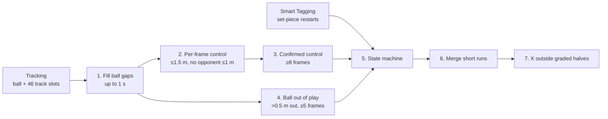
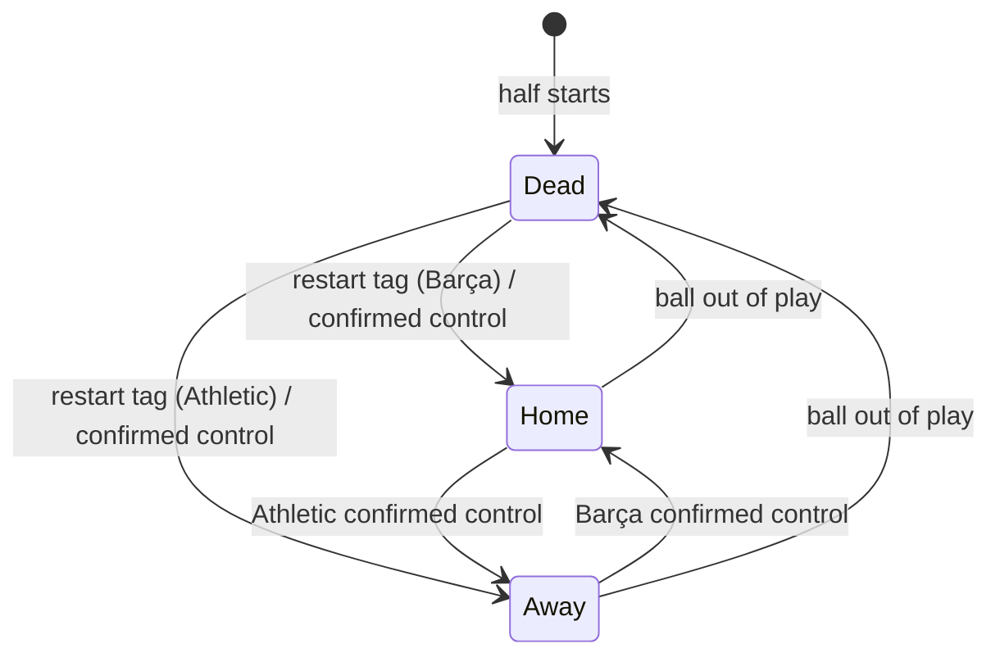

# DX Lab Team 3 — Technical document

More Than a Hack 2027, Initial Challenge: frame-by-frame team possession for FC Barcelona vs
Athletic Club (LaLiga 2024-25, MD2). Submission: `DX_Lab_Team_3.csv`, 199,319 rows.

## 1. Approach

The ranking metric, spellF1, scores **possessions**, not frames. A possession is a maximal run of
`H` or `A`, matched to the truth by temporal IoU. The organisers' baselines make the point: the
nearest-player rule is right on most frames, but it flips team on every pass and loose ball, so
it predicts 131 possessions where the public window has 17 and scores spellF1 0.04.

So the main design question is not "who is closest to the ball on this frame?" but **"when does
possession actually change hands?"** We answer it with a small set of football rules and a state
machine, instead of smoothing a per-frame guess:

- a team gains possession only when it shows **confirmed control** of the ball;
- anything short of that (a deflection, a contested ball, a pass in flight, a frame where the
  tracking lost the ball) **keeps the previous state**;
- the ball is **dead** when it is clearly out of the pitch, and stays dead until a **restart**,
  taken from Smart Tagging, or until play has visibly resumed.

We chose a rule-based system over a learned model on purpose:

1. **The rules forbid fitting to this match.** Training, fitting or calibrating on the ground
   truth or the video is not allowed (rule clarification, Nov 3), and the public ground truth is
   only 5 minutes long anyway.
2. **The ground truth is mechanical.** It is derived from corrected tracking ("owning team" and
   "ball dead"), so explicit geometric rules aim at the same definition.
3. **It is inspectable.** Every decision in the output traces back to one rule and one parameter.

## 2. Assets used, and dropped

| Asset | Used? | How / why not |
|---|---|---|
| Tactical ATD (tracking) | **Yes** | Ball and player positions per frame, team membership per track slot. Read with kloppy's EPTS metadata parser and streaming reader, scaled to metres with the `games.py` pitch (105.3 × 68.0 m). |
| Smart Tagging | **Yes, set pieces only** | The `SET PIECES` code gives restarts (kickoffs, throw-ins, corners, goal kicks, free kicks) and, for most types, the team taking them. They end dead-ball periods. |
| `games.py` | Yes | Pitch size, frame counts and the graded half boundaries. |
| Homography | No | The ATD already gives pitch coordinates, so the camera model adds nothing for a position-based method. |
| Tactical video | No | Not needed for a position-based method. The rules also forbid checking output against it. |
| Broadcast recording | No | Not synchronised to the tactical timeline, and its homography covers only 65.8% of frames. |
| ATD `ball_state` / `ball_owning_team_id` | Checked, dropped | Empty on every frame of this file. |

No external data, no pre-trained models, no manual labels.

## 3. Pipeline and possession rules



### 3.1 Ball gaps
The ball is missing on about 41% of graded frames. Gaps of **up to 25 frames (1 s)** are filled
by linear interpolation between the observed frames on each side. Longer gaps stay empty, and the
state machine holds its state through them rather than guessing.

### 3.2 Control on one frame
A team **controls** the ball on a frame when its nearest player is within **1.5 m** of the ball
and **no opponent is within 1.0 m**. Two opponents close to the ball make it a duel, and a duel
means nobody controls it.

### 3.3 Confirmed control
Control by the same team for **at least 8 consecutive frames (0.32 s)** counts as confirmed. The
gain is dated to the **first** frame of that run, so a possession starts where control began,
not where it was confirmed.

This is our line between "touched" and "controlled". A deflection, a block or a pass flying past
a defender gives a few frames of proximity at most, not 8 frames of uncontested control.

### 3.4 Dead ball
- **Out of play:** the ball is more than **0.5 m** outside a touchline or goal line for at least
  **5 consecutive frames (0.2 s)**. The margin and the run length keep tracking noise near the
  lines from creating false stoppages. A frame with no ball position breaks the run.
- **Restart:** the dead ball ends at whichever comes first:
  - the **next set-piece tag**. Possession goes to the tagged team; when the tag has no team (all
    throw-ins are tagged `N/A`), it goes to the first team to get confirmed control afterwards;
  - the ball **seen back inside the lines, followed by a confirmed control**. This covers restarts
    that Smart Tagging missed.
- **Possible goal:** an exit over a goal line **between the posts** (half-width 3.66 m, Law 1,
  plus 0.5 m) ends only at the next **kickoff, goal kick or corner** tag. Without this, players
  carrying the ball back to the centre spot after a goal would look like play resuming. The
  tracking has no ball height, so a shot over the bar looks like a goal; it is followed by a goal
  kick or a corner, which ends it correctly.
- **Start of each half:** the half starts dead and goes live at its kickoff tag. A tag whose
  window covers the first graded frame fires on that frame.

### 3.5 The state machine
While the ball is live, possession changes **only** when the *other* team gets confirmed control.
Frames with no control, contested frames and frames without a ball keep the current team.



### 3.6 Short runs and ungraded time
- Possession runs shorter than **1 s (25 frames)** and dead-ball runs shorter than **2 s
  (50 frames)** are merged into the run before them. A one-frame flicker should not count as a
  possession.
- Frames outside the two graded halves (before kickoff, half-time, after the final whistle) are
  `X`.

### 3.7 Where we drew the lines

| Situation | Our rule |
|---|---|
| Loose ball, nobody close | Previous team keeps possession |
| 50/50 challenge | Duel: nobody controls it, previous team keeps possession |
| Deflection or block | Not 8 frames of uncontested control, so no change |
| Pass in flight | Previous team keeps possession until a player controls it |
| Throw-in, corner, goal kick, free kick | Dead from ball-out until the restart tag |
| Goal | Dead until the kickoff |
| Foul (ball stays on the pitch) | Not detected: play is treated as live (see Limitations) |

## 4. Parameters and where they come from

Nothing was trained or tuned. Every value is in `src/possession/config.py`, with its source.

| Parameter | Value | Source |
|---|---|---|
| Ball gap to interpolate | 25 frames (1 s) | databallpy's tracking-quality check flags ball gaps of ≥ 1 s |
| Control radius | 1.5 m | databallpy default `pz_radius`, an implementation of Vidal-Codina et al. (2022); the paper used 0.5–1 m and suggests a larger radius for lower-quality tracking such as ours |
| Duel radius | 1.0 m | Vidal-Codina et al. (2022), duel zone `R_dz = 1 m` for all providers |
| Minimum possession run | 25 frames (1 s) | Link & Hoernig (2017): "very short sections (< 1 s) are excluded" |
| Goal half-width | 3.66 m | IFAB Laws of the Game, Law 1 (7.32 m between the posts) |
| Confirmed control | 8 frames | Design choice (no literature value) |
| Out-of-pitch margin and run | 0.5 m, 5 frames | Design choice, to reject tracking noise near the lines |
| Goal-mouth margin | 0.5 m | Design choice, same as the out margin |
| Minimum dead-ball run | 50 frames (2 s) | Design choice |
| Restart anchor | start of the tag window | Design choice |

All design choices were fixed **before** we scored them, from how the game works. None was chosen
by comparing scores.

## 5. Results

On the public 5-minute window (official scorer, unmodified):

| | spellF1 | macroF1 | possessions | mean duration | fragmentation |
|---|---|---|---|---|---|
| **DX Lab Team 3 (v1)** | **0.388** | 0.601 | 16 | 18.2 s | 0.81 |
| `baseline_smooth125` | 0.424 | 0.581 | 16 | 18.5 s | 0.81 |
| `baseline_smooth50` (published floor) | 0.326 | 0.621 | 26 | 10.8 s | 1.43 |
| `baseline_raw` | 0.038 | 0.597 | 131 | 2.0 s | 6.52 |
| Ground truth | — | — | 17 | 14.2 s | — |

Over the full match the pipeline predicts 310 possessions (mean 18.1 s). Of the 158,857 graded frames: 47.3% H,
41.0% A, 11.7% D.

`baseline_smooth125` scores higher on this window, but the gap is inside the noise band of a
17-possession sample, and the organisers show `smooth125` is worse than `smooth50` over the full
match. We did not tune anything to close that gap: doing it on the public window would be fitting
to the ground truth.

### How the public window was used
Only to check correctness. The first version predicted **2 possessions** on the public window.
A counts-only diagnostic summary (`src/possession/diagnostics.py`) showed why: the first-half
kickoff tag's window opens just before the first graded frame, so the tag was anchored outside the
half and never ended the pre-kickoff dead ball. The first 6,348 frames of play were labelled `D`.
We fixed the anchoring rule (a tag covering a half's first graded frame fires on that frame). That
is a bug fix, not a parameter change, and no parameter value changed as a result.

## 6. Limitations, and what we would do next

- **Fouls are not detected.** The ball stays on the pitch, so those stoppages read as live play.
  Next step: detect a stoppage from collective movement, such as team-wide speed collapsing while
  the ball stands still, as in published work on detecting game interruptions from tracking data.
- **Long ball gaps.** When the ball is missing for more than 1 s, the state holds, so a change of
  possession inside the gap is found late or missed. Next step: infer the ball's likely side from
  team shape and movement, or estimate the ball's position with a Kalman smoother.
- **No ball height.** Shots over the bar and goals look the same. We resolve it through the
  restart that follows; the event tags could resolve it directly.
- **Short possessions after restarts** can be merged into the dead ball by the 1 s rule.
- **Smart Tagging dependence.** A missing or mistimed set-piece tag delays the end of a dead
  ball, unless the "back inside + confirmed control" exit catches it.
- **The design choices are untested on other data.** Next step: check them on external data with
  possession labels, which the rules allow.

## 7. Reproduction

```bash
uv sync --frozen                    # Python 3.11, exact versions from uv.lock
# put the data bundle in ./data (see data/README.md) or set MTAH_DATA_DIR
make submission TEAM=DX_Lab_Team_3  # writes submissions/DX_Lab_Team_3.csv, validates, scores
make reproduce  TEAM=DX_Lab_Team_3  # builds twice and checks the files are byte-identical
make test                           # unit tests on synthetic data only
```

The pipeline is deterministic. `make verify-scorer` checks that the organisers' scorer, public
ground truth and `games.py` are unmodified. The match data is not in this repository.

## 8. Compliance

- Labels come from the algorithm only. There is no hand annotation and no manual data.
- Nothing was trained, fitted or calibrated on the ground truth or the video. The public ground
  truth was used for correctness checks only (section 5).
- We did not check our output against the video.
- AI coding assistants were used to help write code and documentation. After the organisers'
  rule clarification of Nov 3, no match data was given to any AI service. The code was run on the
  data locally, and only error messages, aggregate counts and scores were shared.
  <!-- REVIEW: before Nov 3, screenshots of the organisers' starter-notebook output were shared
       with an AI assistant while exploring the data. Decide whether to state that here. -->

## References

- Vidal-Codina, F., Evans, N., El Fakir, B., & Billingham, J. (2022). Automatic event detection in
  football using tracking data. *Sports Engineering*, 25, 18.
- Link, D., & Hoernig, M. (2017). Individual ball possession in soccer. *PLoS ONE*, 12(7),
  e0179953.
- databallpy (Alek050/databallpy), `add_individual_player_possession` and tracking-quality checks.
- IFAB, *Laws of the Game*, Law 1: The Field of Play.
- kloppy (PySport), Metrica EPTS reader.
